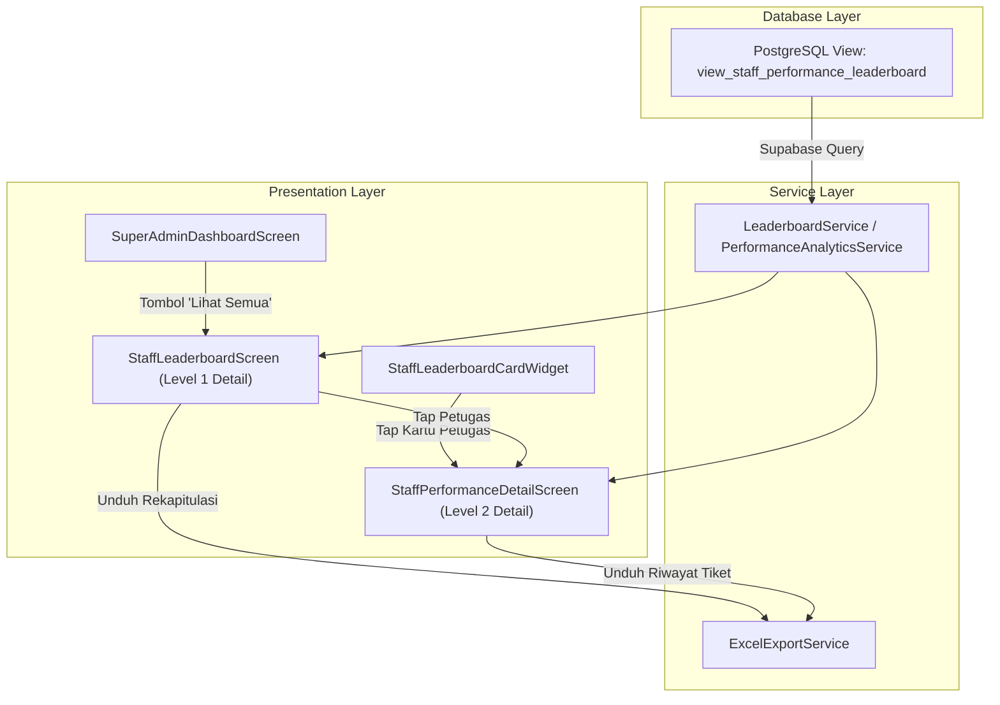

# Rencana Implementasi: Halaman Detail Leaderboard Kinerja Petugas & Ekspor XLSX (Super Admin)

## Goal Description
Fitur ini bertujuan untuk melengkapi modul analitik kinerja layanan Helpdesk BOSDM Connect bagi **Super Admin** dengan:
1. **Database Supabase**: Membuat file migrasi SQL view PostgreSQL dinamis (`view_staff_performance_leaderboard`) untuk menghitung performa staf/petugas secara otomatis dan realtime dari relasi tabel `answers`, `questions`, dan `profiles`.
2. **Halaman Daftar Lengkap Leaderboard (`StaffLeaderboardScreen`)**: Menampilkan seluruh ranking petugas/staf dengan filter tim/kawasan, bar pencarian, visualisasi medali/peringkat, dan tombol "Download Laporan (.xlsx)".
3. **Halaman Detail Kinerja Individu Petugas (`StaffPerformanceDetailScreen`)**: Terbuka saat salah satu nama petugas diklik; menampilkan profil, kartu ringkasan KPI, distribusi kepuasan rating CSAT & tag ulasan, serta daftar riwayat tiket yang ditangani beserta tombol unduh riwayat tiket Excel.
4. **Ekspor Excel (.xlsx)**: Mengintegrasikan package `excel`, `path_provider`, dan `open_filex` untuk menyimpan file Excel ke penyimpanan lokal dan memunculkan notifikasi SnackBar berhasil beserta tombol action 'Buka'.
5. **Akses Terbatas**: Fitur ini dikunci secara eksklusif hanya untuk peran **Super Admin**.

---

## User Review Required

> [!IMPORTANT]
> **Penambahan Dependensi Baru di `pubspec.yaml`**:
> - `excel: ^4.0.6` (pembuat format berkas spreadsheet `.xlsx` pure Dart)
> - `path_provider: ^2.1.5` (akses folder berkas lokal di Android/iOS)
> - `open_filex: ^4.7.0` (membuka file Excel langsung dengan aplikasi spreadsheet default perangkat)
>
> Semua library ini kompatibel dengan Flutter SDK `>=3.2.6 <4.0.0` dan didukung di Android & iOS.

> [!NOTE]
> **Keberadaan Database View Supabase**:
> File migrasi SQL akan ditaruh di `supabase/migrations/20261026_staff_performance_leaderboard_view.sql` dan `lib/core/network/supabase_leaderboard_view.sql`. Jika aplikasi dijalankan dalam mode offline atau tabel Supabase belum dieksekusi migrasinya, sistem memiliki fallback berjenjang otomatis ke kalkulasi in-memory Dart (`PerformanceAnalyticsService.getStaffPerformanceLeaderboard`) sehingga aplikasi tidak akan mengalami crash.

---

## Proposed Changes



---

### 1. Database & Migrasi Supabase

#### [NEW] `supabase/migrations/20261026_staff_performance_leaderboard_view.sql` & `lib/core/network/supabase_leaderboard_view.sql`
- Membuat PostgreSQL View `public.view_staff_performance_leaderboard` yang menghitung:
  - `staff_id`: UUID dari `profiles.id` atau user_id di answers
  - `staff_name`: Nama petugas/staf
  - `role`: Role akun petugas (admin_lksdm, admin_pusat, ketua_tim, super_admin)
  - `team_or_lksdm`: Asal tim / kawasan penanganan
  - `total_tickets_handled`: Jumlah tiket unik yang pernah dijawab petugas
  - `total_answers`: Jumlah balasan pesan yang dikirim
  - `total_closed_tickets`: Jumlah tiket ditangani yang sudah selesai/closed
  - `avg_rating`: Rata-rata rating bintang CSAT (1-5)
  - `rating_count`: Jumlah ulasan bintang yang diterima
  - `gercep_count`: Jumlah tiket yang pertama kali direspon dalam waktu <= 2 jam
  - `gercep_rate`: Persentase kecepatan respon (gercep)
- Mengaktifkan `GRANT SELECT ON public.view_staff_performance_leaderboard TO authenticated;`

---

### 2. Core Services & Dependensi

#### [MODIFY] `pubspec.yaml`
- Menambahkan dependensi:
  ```yaml
  excel: ^4.0.6
  path_provider: ^2.1.5
  open_filex: ^4.7.0
  ```

#### [NEW] `lib/core/services/export/excel_export_service.dart`
- Kelas utilitas pembantu untuk generate file `.xlsx`:
  - `exportStaffLeaderboardToExcel(List<StaffPerformanceStat> staffList)`:
    - Menghasilkan lembar kerja "Leaderboard Kinerja BOSDM".
    - Kolom: `No`, `Nama Petugas`, `Role`, `Tim / Kawasan`, `Total Tiket Ditangani`, `Tiket Selesai`, `Rata-rata Rating CSAT`, `Total Ulasan Rating`, `Respon Cepat (Gercep)`, `Persentase Gercep`, `Total Jawaban`.
    - Format styling header: latar belakang abu-abu terang, teks tebal, border sel, penyesuaian lebar kolom otomatis.
  - `exportStaffTicketHistoryToExcel(StaffPerformanceStat staff, List<QuestionModel> tickets)`:
    - Menghasilkan lembar kerja "Riwayat Tiket - [Nama Petugas]".
    - Kolom: `No`, `No. Tiket`, `Judul Pertanyaan`, `Kategori Tusi`, `Asal Pemohon`, `Tanggal Masuk`, `Status`, `Rating Bintang`, `Ulasan / Catatan Kepuasan`.
  - Fungsi penyimpanan berkas lokal menggunakan `path_provider` (folder Application Documents / Downloads) dan mengembalikan path berkas yang tersimpan.

---

### 3. Service Layer (Analytics & Database)

#### [MODIFY] `lib/features/dashboard/services/performance_analytics_service.dart`
- Menambahkan metode query ke Supabase:
  - `fetchStaffLeaderboardFromSupabase({String? teamFilter})`:
    - Mengambil data dari view `view_staff_performance_leaderboard`.
    - Jika gagal atau offline, otomatis fallback ke pemrosesan in-memory data `QuestionModel` yang ada.
- Menambahkan model serializer untuk mendukung pemetaan dari view Supabase ke `StaffPerformanceStat`.

---

### 4. Presentation Layer (UI Screens & Widgets)

#### [NEW] `lib/features/dashboard/screens/staff_leaderboard_screen.dart`
- Halaman Level 1:
  - **AppBar**: Judul "Leaderboard Kinerja Petugas", dengan tombol aksi `Download Laporan (.xlsx)`.
  - **Filter Section**: Pilihan filter kategori Kawasan / Tim (Semua Tim, LKSDM 1-8, Tim Pusat 1-14) dengan horizontal scrolling chips.
  - **Search Bar**: Kolom input pencarian instan nama atau role petugas.
  - **Top Summary Cards**: 3 kartu ringkasan di bagian atas (Total Petugas Aktif, Rata-rata Kepuasan CSAT Global, Total Tiket Ditangani).
  - **Leaderboard List**: Menampilkan kartu peringkat petugas secara urut dari rank 1 ke bawah:
    - Medali emas (#1), perak (#2), perunggu (#3).
    - Avatar inisial, nama, role badge, dan nama tim.
    - Metrik KPI: Total Tiket, Bintang Rating, Tag Gercep.
    - Indikator panah `>` untuk membuka detail individu.
  - **Event Tap**: Navigasi ke `StaffPerformanceDetailScreen`.
  - **Aksi Download**: Memanggil `ExcelExportService`, menyimpan file, dan memunculkan `SnackBar` sukses: *"Laporan berhasil diunduh ke [nama_file].xlsx"* dengan tombol action **Buka** yang membuka berkas via `OpenFilex.open(filePath)`.

#### [NEW] `lib/features/dashboard/screens/staff_performance_detail_screen.dart`
- Halaman Level 2:
  - **AppBar**: Judul "Detail Kinerja Petugas", tombol aksi `Download Riwayat (.xlsx)`.
  - **Header Card**: Avatar besar petugas, nama lengkap, role badge, tim/kawasan, serta rank badges.
  - **Stat Grid (4 Kartu)**:
    1. Tiket Ditangani (Total tiket ditangani & tiket selesai).
    2. Rating Kepuasan CSAT (Bintang rata-rata & jumlah ulasan).
    3. Kecepatan Respon (Skor Gercep <= 2 jam & persentase).
    4. Total Respon / Balasan (Jawaban interaktif dalam percakapan).
  - **Ulasan & Tag Layanan**: Distribusi tag ulasan positif pegawai (Ramah & Solutif, Jawaban Jelas & Akurat, Respon Cepat).
  - **Daftar Riwayat Tiket yang Ditangani**:
    - Menampilkan kartu tiket yang ditangani oleh staf ini.
    - No. tiket, judul, tusi, tanggal tiket dibuat, status tiket (selesai / dialihkan), dan bintang rating yang diberikan pegawai pada tiket tersebut.
    - Tap pada tiket dapat membuka `QuestionDetailScreen`.
  - **Aksi Download Riwayat**: Mengunduh seluruh tiket yang ditangani oleh staf bersangkutan ke format `.xlsx` dengan SnackBar dan tombol `Buka`.

#### [MODIFY] `lib/features/dashboard/widgets/performance_analytics_widgets.dart`
- Di `StaffLeaderboardCardWidget`:
  - Mengaktifkan tombol `Lihat Semua` di header kartu jika `onViewAll` diberikan.
  - Menjadikan setiap item baris petugas di leaderboard dapat diklik (`InkWell` / `onTap`) untuk langsung membuka `StaffPerformanceDetailScreen`.

#### [MODIFY] `lib/features/dashboard/screens/super_admin_dashboard_screen.dart`
- Memasang handler `onViewAll` pada `StaffLeaderboardCardWidget` yang mengarahkan Super Admin ke `StaffLeaderboardScreen`.
- Mengoper daftar pertanyaan/tiket terkini agar halaman leaderboard dan detail petugas selalu memiliki data yang sinkron.

---

## Verification Plan

### Automated Tests
1. **Analisis Statis & Linting**:
   ```sh
   flutter analyze
   ```
   *Target: 0 errors, 0 warnings.*
2. **Unit & Widget Tests**:
   ```sh
   flutter test test/widget_test.dart
   ```
   *Target: Semua tes widget lulus.*

### Manual Verification
1. **Navigasi Leaderboard**:
   - Login sebagai Super Admin (`superadmin@brin.go.id`).
   - Masuk ke Dashboard Super Admin.
   - Gulir ke kartu "Leaderboard Kinerja Petugas & Staf Admin".
   - Tekan tombol "Lihat Semua".
   - Pastikan masuk ke halaman `StaffLeaderboardScreen` dengan daftar seluruh staf.
2. **Filter & Pencarian**:
   - Ketik nama staf di bar pencarian; pastikan daftar menyaring secara instan.
   - Klik chip filter tim (misal "LKSDM 1" atau "Tim Ortala"); pastikan daftar terfilter sesuai asal unit/tim.
3. **Download Laporan Leaderboard XLSX**:
   - Tekan tombol icon download di AppBar atau tombol "Download Laporan (.xlsx)".
   - Pastikan muncul loading dan SnackBar sukses berwarna hijau dengan teks *"Laporan berhasil diunduh: [nama_file].xlsx"*.
   - Tekan tombol "Buka" pada SnackBar; pastikan aplikasi spreadsheet membuka file Excel dengan data yang rapi dan terformat.
4. **Halaman Detail Kinerja Individu**:
   - Klik salah satu kartu staf di Leaderboard.
   - Pastikan terbuka halaman `StaffPerformanceDetailScreen` dengan nama staf yang tepat, 4 kartu metrik KPI, distribusi tag ulasan, dan daftar tiket yang pernah ditangani.
   - Tekan tombol "Download Riwayat Tiket (.xlsx)"; pastikan file riwayat tiket staf tersebut tersimpan dan dapat dibuka.
5. **Keamanan Akses Role**:
   - Verifikasi bahwa halaman detail dan tombol unduh hanya dapat diakses melalui role Super Admin.
