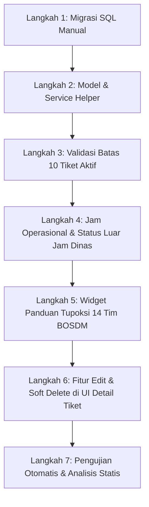

# Rencana Desain & Implementasi: Batasan Tiket, Jam Operasional SLA, Panduan Tupoksi, dan Fitur Edit/Hapus

Dokumen ini memuat arsitektur, aturan bisnis, dan langkah-langkah implementasi teknis untuk 4 fitur utama dan panduan migrasi database pada aplikasi **BOSDM Connect (Forum BRIN Mobile)**.

---

## 1. Ikhtisar Kebutuhan & Kesepakatan Bisnis

| Fitur | Aturan Bisnis & Spesifikasi |
| :--- | :--- |
| **1. Batasan Tiket Aktif** | Maksimal **10 tiket aktif** (status belum selesai/CLOSED) secara bersamaan per pegawai. Jika sudah ada 10 tiket aktif, pengajuan tiket baru dicegah dengan dialog peringatan ramah. |
| **2. Jam Operasional & SLA** | **Senin – Jumat, pukul 08:00 – 16:00 WIB**. Di luar jam dinas (malam/akhir pekan/libur), pegawai tetap dapat mengirim tiket dengan label status `antrean_luar_jam_kerja`. Penghitungan timer SLA staf **tidak berjalan di luar jam dinas** dan baru aktif pada hari kerja berikutnya pukul 08:00 WIB. Staf tetap fleksibel membalas jika berkenan. |
| **3. Box Informasi Tupoksi Tim BOSDM** | Banner ringkas / tombol info *"💡 Panduan Tupoksi 14 Tim BOSDM"* yang tidak mengganggu UI. Saat ditekan, membuka **Modal Bottom Sheet interaktif** dengan fitur pencarian real-time dan daftar lengkap tugas/fungsi 14 tim BOSDM. Tersedia di `AskQuestionScreen` dan Dashboard. |
| **4. Fitur Edit & Hapus (Soft Delete)** | **Batas Waktu Edit**: Maksimal **15 menit** pertama sejak dibuat/dikirim, dan belum ada respons tindak lanjut. Ditandai badge `(Diedit)`.<br>**Aturan Hapus (Soft Delete)**: Tiket hanya bisa dibatalkan jika belum mulai ditangani staf (status berubah `dibatalkan`). Pesan balasan yang ditarik bertuliskan *"Pesan telah ditarik"*. Tidak menghapus baris database fisik (*audit safe*). |
| **5. Panduan Database** | Skrip SQL perubahan skema disimpan di `supabase/manual_migration/01_operational_hours_and_soft_delete.sql` agar mudah dieksekusi manual kapan saja di Supabase Console. |

---

## 2. Skema & Perubahan Database (`supabase/manual_migration/`)

Berkas migrasi: `supabase/manual_migration/01_operational_hours_and_soft_delete.sql`

```sql
-- 1. Tambah kolom soft delete & audit edit pada tabel questions
ALTER TABLE public.questions
ADD COLUMN IF NOT EXISTS is_deleted BOOLEAN NOT NULL DEFAULT FALSE,
ADD COLUMN IF NOT EXISTS deleted_at TIMESTAMPTZ,
ADD COLUMN IF NOT EXISTS deleted_by UUID REFERENCES public.users(id_user),
ADD COLUMN IF NOT EXISTS is_edited BOOLEAN NOT NULL DEFAULT FALSE,
ADD COLUMN IF NOT EXISTS edited_at TIMESTAMPTZ,
ADD COLUMN IF NOT EXISTS is_off_hours BOOLEAN NOT NULL DEFAULT FALSE,
ADD COLUMN IF NOT EXISTS sla_start_at TIMESTAMPTZ;

-- 2. Tambah kolom soft delete & edit pada tabel answers
ALTER TABLE public.answers
ADD COLUMN IF NOT EXISTS is_deleted BOOLEAN NOT NULL DEFAULT FALSE,
ADD COLUMN IF NOT EXISTS deleted_at TIMESTAMPTZ,
ADD COLUMN IF NOT EXISTS deleted_by UUID REFERENCES public.users(id_user),
ADD COLUMN IF NOT EXISTS is_edited BOOLEAN NOT NULL DEFAULT FALSE,
ADD COLUMN IF NOT EXISTS edited_at TIMESTAMPTZ;

-- 3. Perbarui Enum / Constraint status pada tabel questions
-- Tambahkan status baru: 'antrean_luar_jam_kerja' dan 'dibatalkan'
DO $$
BEGIN
    IF EXISTS (
        SELECT 1 FROM information_schema.constraint_column_usage 
        WHERE table_name = 'questions' AND constraint_name = 'questions_status_check'
    ) THEN
        ALTER TABLE public.questions DROP CONSTRAINT questions_status_check;
        ALTER TABLE public.questions ADD CONSTRAINT questions_status_check 
        CHECK (status IN (
            'menunggu_lksdm', 
            'ditangani_lksdm', 
            'dialihkan_ke_pusat', 
            'selesai', 
            'dibatalkan',
            'antrean_luar_jam_kerja',
            'tiket_mandiri_lksdm'
        ));
    END IF;
END $$;

-- 4. Indeks performa untuk pengecekan tiket aktif dan filter status
CREATE INDEX IF NOT EXISTS idx_questions_user_active ON public.questions(user_id, status) WHERE is_deleted = FALSE;
CREATE INDEX IF NOT EXISTS idx_questions_is_off_hours ON public.questions(is_off_hours);
```

---

## 3. Detail Arsitektur & Logika Komputasi

### A. Penghitungan Batasan 10 Tiket Aktif (`QuestionService.countUserActiveTickets`)
```dart
// Mengecek seluruh tiket aktif milik pengguna (status bukan 'selesai' dan bukan 'dibatalkan', serta is_deleted = false)
final activeCount = await QuestionService.getUserActiveTicketCount(userId: userId);
if (activeCount >= 10) {
  // Blokir pembuatan tiket baru dan tampilkan dialog penjelasan
}
```

### B. Helper Jam Operasional & SLA (`OperationalHoursHelper`)
Waktu Operasional: **Senin s/d Jumat, 08:00 - 16:00 WIB** (UTC+7).
```dart
class OperationalHoursHelper {
  static const int openHour = 8;
  static const int closeHour = 16;
  
  static DateTime nowWib() => DateTime.now().toUtc().add(const Duration(hours: 7));

  static bool isWithinWorkingHours([DateTime? dateTime]) {
    final dt = dateTime ?? nowWib();
    if (dt.weekday == DateTime.saturday || dt.weekday == DateTime.sunday) {
      return false; // Akhir pekan
    }
    final hour = dt.hour;
    return hour >= openHour && hour < closeHour;
  }

  static DateTime getNextSlaStartTime([DateTime? dateTime]) {
    final dt = dateTime ?? nowWib();
    if (isWithinWorkingHours(dt)) return dt;
    
    // Cari hari kerja berikutnya pukul 08:00 WIB
    DateTime next = DateTime(dt.year, dt.month, dt.day, openHour, 0);
    if (dt.hour >= closeHour) {
      next = next.add(const Duration(days: 1));
    }
    while (next.weekday == DateTime.saturday || next.weekday == DateTime.sunday) {
      next = next.add(const Duration(days: 1));
    }
    return next;
  }
}
```

### C. Komponen Panduan Tupoksi 14 Tim BOSDM (`TupoksiBottomSheet`)
- **Penempatan**:
  1. `AskQuestionScreen`: Tombol/Banner compact di bagian atas formulir *"💡 Ragu memilih tujuan? Lihat Panduan Tupoksi 14 Tim BOSDM"*.
  2. `DashboardScreen`: Tombol *"Buku Saku Tupoksi BOSDM"* di bagian FAQ/Layanan.
- **Fitur Modal**:
  - Kolom pencarian instan (contoh mengetik *"cuti"*, *"disiplin"*, *"pensiun"*, *"SK"* langsung menyaring tugas & fungsi tim terkait).
  - Tampilan accordion atau chip bersih dengan warna identitas BOSDM Connect.

### D. Fitur Edit & Soft Delete (15 Menit Window)
1. **Aturan Tombol Edit**:
   - `canEditQuestion`: `currentUser.id == question.userId && now.difference(createdAt).inMinutes <= 15 && question.answers.isEmpty`.
   - `canEditAnswer`: `currentUser.id == answer.userId && now.difference(createdAt).inMinutes <= 15`.
2. **Aturan Tombol Hapus (Batalkan)**:
   - `canCancelQuestion`: `currentUser.id == question.userId && question.status == 'menunggu_lksdm' && question.answers.isEmpty`.
   - Saat dibatalkan, status tiket menjadi `dibatalkan` dan `is_deleted = true`.
3. **Tampilan UI**:
   - Gelembung pesan yang diedit menampilkan teks kecil *"diedit"*.
   - Gelembung pesan yang ditarik menampilkan kotak bergaris putus-putus dengan teks *"Pesan ini telah ditarik oleh pengirim"*.

---

## 4. Rencana Tahapan Eksekusi



1. **Langkah 1**: Buat skrip migrasi SQL lengkap di `supabase/manual_migration/01_operational_hours_and_soft_delete.sql`.
2. **Langkah 2**: Perbarui `QuestionModel` dan `AnswerModel` untuk mendukung properti `isDeleted`, `isEdited`, `slaStartAt`, `isOffHours`, serta tambahkan `OperationalHoursHelper`.
3. **Langkah 3**: Tambahkan pengecekan `getUserActiveTicketCount` di `QuestionService` dan validasi kuota 10 tiket di `AskQuestionScreen`.
4. **Langkah 4**: Terapkan logika penandaan luar jam kerja pada pembuatan tiket dan penyesuaian SLA di `QuestionService`.
5. **Langkah 5**: Bangun widget `TupoksiBottomSheet` yang compact & searchable, lalu pasang di `AskQuestionScreen` dan `DashboardScreen`.
6. **Langkah 6**: Tambahkan aksi Edit & Hapus (dengan dialog konfirmasi & batas 15 menit) pada `QuestionDetailScreen` untuk pertanyaan dan jawaban.
7. **Langkah 7**: Tulis unit test komprehensif di `test/features/questions/operational_rules_test.dart` dan jalankan `flutter test` serta `flutter analyze`.

---

## 5. Pertimbangan & Backward Compatibility

- Data tiket lama yang belum memiliki kolom baru akan diisi nilai bawaan (`is_deleted = false`, `is_edited = false`).
- Staf tetap memiliki keleluasaan penuh dan tidak diblokir saat ingin merespons di luar jam kantor, namun performa SLA mereka terlindungi secara adil.
- Tidak ada data yang hilang permanen dari database saat pengguna membatalkan tiket, menjaga kepatuhan rekam jejak audit instansi.
